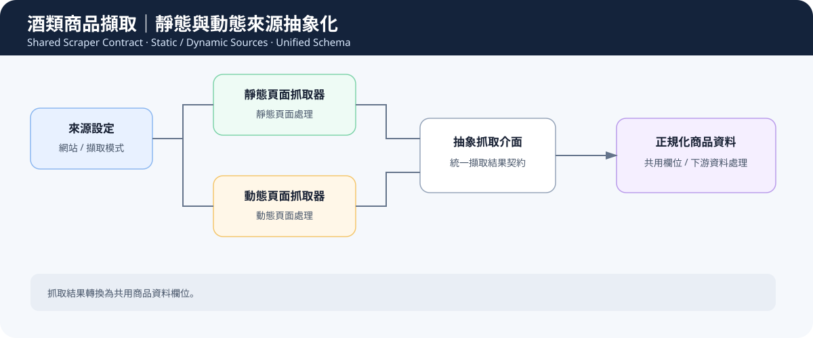

# 酒類商品資料擷取

## 處理的問題
不同網站提供靜態或動態商品頁面；抓取流程將來源差異交由不同實作處理，再整理成共用商品欄位。

以抽象抓取方式處理靜態與動態網站的酒類商品資訊，並將擷取結果轉成統一資料規格。

## 擷取架構

- 抽象抓取介面定義來源抓取器的共同呼叫方式。
- 靜態與動態網站由不同抓取實作處理。
- 各來源資料轉成共用欄位格式後交給後續流程。

English: A web-scraping system that handles static and dynamic sites through an abstract interface and normalizes output to a shared schema.
